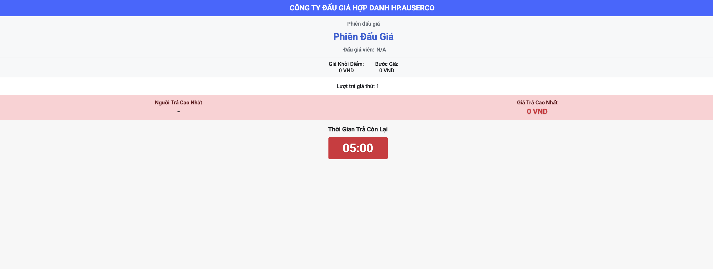

# Layout Improvement: Popup Window

## Overview
The current layout of the popup window (see image below) is unbalanced, with excessive dead space. This results in a poor user experience and inefficient use of screen real estate. If there is significant unused space, consider increasing the size of banners, text, labels, and buttons to improve usability.



---

## Requirements

### Current Issues
1. Components are not evenly distributed, leading to visual imbalance.
2. Excessive dead space reduces the usability and aesthetic appeal of the popup.

### Expected Improvements
1. **Even Distribution**:
   - Ensure all components are evenly distributed within the popup window.
   - Align components to create a visually balanced layout.

2. **Efficient Use of Space**:
   - Minimize dead space by resizing or repositioning components as needed.
   - Ensure the layout adapts well to different screen sizes (responsive design).

3. **Aesthetic Enhancements**:
   - Use consistent spacing and alignment for all elements.
   - Maintain a clean and professional design.
   - Increase the size of banners, text, labels, and buttons if there is excessive unused space.

---

## Implementation Notes
- Use a grid-based layout system (e.g., CSS Grid or Flexbox) to achieve even distribution of components.
- Test the layout on various screen sizes to ensure responsiveness.
- Ensure accessibility standards are met (e.g., proper contrast, readable font sizes).

### CSS Injection
- The CSS code must be injected directly into the popup window component to ensure it works correctly.
- Reference the `StyledContainer` example below for guidance:

```
const StyledContainer = styled.div`
  /* Auction auctioneer */
  .auction-auctioneer {
    font-size: calc(14px + 0.5vmin);
    margin-top: 5px;
    color: #6c757d;
  }
  /* Add additional styles here for layout improvements */
  .popup-banner {
    font-size: calc(16px + 1vmin);
    text-align: center;
    margin-bottom: 10px;
  }
  .popup-button {
    padding: 10px 20px;
    font-size: calc(14px + 0.5vmin);
  }
`;
```


